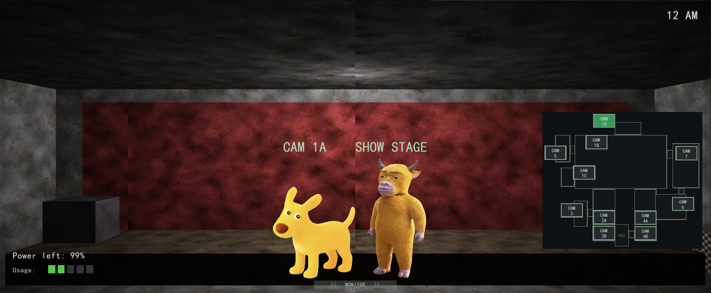
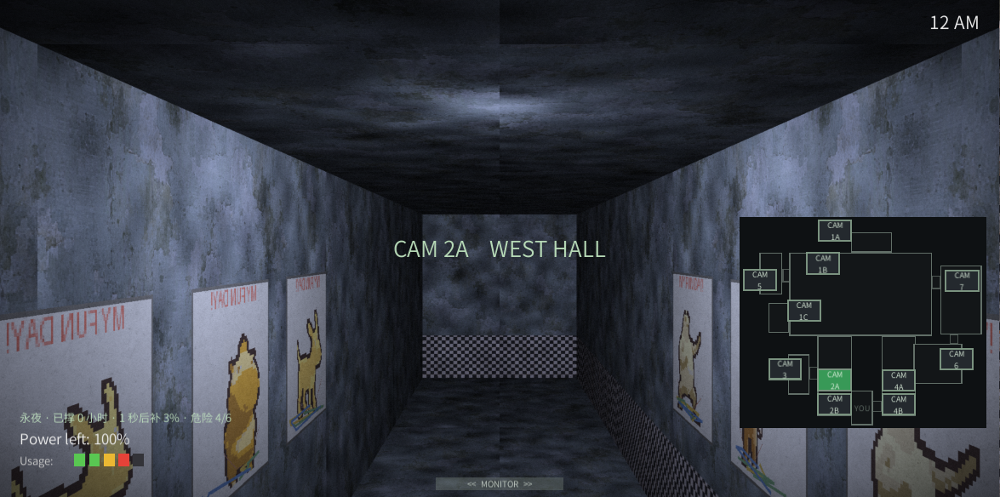

# 奶龙的五夜后宫

一个 FNAF 味儿的第一人称生存恐怖：你坐在保安室里，位置固定，不能走，只能转头。
撑过一夜的办法是看监控、关门、开灯、拿手电筒照人，以及别把电用光。

Unity 2022.3 LTS + C# 写的，只跑 Windows，界面全中文。下面这些大部分是踩出来的，不是设计出来的。


## 怎么玩

办公室里有三样东西能救你：门、灯、监控。另有一样只能救你一次——手电筒。

鼠标在屏幕哪儿，镜头就往哪儿偏，推到两侧边缘能满转 70°，就这么点视野。左边一扇门、右边一扇门，
墙上各有一块 DOOR 和一块 LIGHT。灯是要开的：**门关着看不见人，灯不开也看不见人**，
而这两样都吃电。监控在屏幕底部，鼠标压到底边就会升起来，右侧小地图点 CAM 框切机位，
一共 11 个，其中厨房（CAM 6）只有声音、没有画面——这是故意的。

手电筒在屏幕正中间偏下，按住才亮，松手就灭。它只对着正门，是专门留给噜噜的。

时钟在右上角，电量和 Usage 五格条在左下角，位置照官方摆的。每夜 12 点到 6 点，现实里大约八分半。



## 那四位

| 谁 | 从哪来 | 怎么挡 |
|---|---|---|
| 袋鼠 `daishu` | 左门 | 关门 |
| 牛来 `niulai` | 右门 | 关门 |
| 奶龙 `nailong` | 右门（跟牛来共用一条路） | 关门；它偷电时切监控看它一眼 |
| 噜噜 `lulu` | **正门** | 手电筒照，闪够 4 次它才走 |

边路是照 FNAF 1 原版分的：袋鼠对标邦尼，牛来对标奇卡，噜噜对标二代的狐狸。

奶龙是最麻烦的那只，因为它两头使坏。平时它蹲在机位上偷电，每偷到一次就转成门类敌人、
顺着右门那条路往前挪一步；被门挡回去，又回去偷电，来回循环。你要是不理它，它迟早自己溜达到门口。

电用光了它还会来收电费，分三段演，全程 18 秒：先是两秒纯黑，然后它从左门现形，八音盒的
托雷多进行曲响起来，脸跟着拍子一亮一暗；音乐停，屏幕彻底黑掉；再然后才动手。

## 屋里还有一个人

**奶包**，豆包，这屋里唯一会说话的东西。她不咬人，也不偷电 —— 她只让你误判。

第 1 夜她是戴夫那种角色：教你看监控、认门灯、按手电筒，五句话说完就闭嘴。第 2 夜起她开始「手欠」，
三十秒后第一次出手，之后每半分多钟来一次，四件事轮着做：偷偷把你的用电拧高一档、抢你的监控两秒多、
关掉你正开着的一盏灯、或者纯粹嘴你一句。她每次出手都要说一句话，立绘也跟着换脸。

她的伤害永远是「你以为你安全了」。比如她说「我帮你把门关上了」，而门其实没关 —— 这类话只出现在字幕里，
不改变任何游戏状态，所以玩久了你会学会不信她。永夜模式里她不在场，那一局已经够忙了。

还有一件小事：如果你真是被她坑死的 —— 抢监控、关灯、偷加耗电，这三件里任意一件刚发生几秒你就被抓了 ——
她会在死亡画面上站出来道歉。「对不起，刚才监控是我按住的。我想替你看一眼，可我什么都没看见。」
语气照现实里豆包的来：先认，再解释，不推诿。纯嘴你一句不算她的锅，那种情况她不会认。

桌上那部手机就是她 —— 它是**钉在桌子上的实物**，不是贴在屏幕上的按钮。转头把视点挪到它那边，
它会亮起来、浮出一行「点一下 · 和她说话」，这时候点它才接通。往后夜越深，她说的话越不像话。

**通话期间她不动手**（抢走的监控也还给你），代价是这段时间用电多算一格；挂断之后她还得等满
一个间隔才重新开始闹。所以电话不是免费按钮：泡在里面就是拿电买安静。

接通之后屏幕下方只浮出一条**字幕**（手电筒上面那一行），**不挡任何操作** —— 门、灯、监控、手电筒
照点，只是多了一行字陪你说。她的表情也跟着台词换：笑、撇嘴、坏笑——模型没有骨骼，所谓「差分」
就是同一个手机壳换一张脸（`Assets/Resources/NaibaoPhone/naibao_phone_{happy,pout,smirk}.fbx`）。

台词本在 `Assets/Scripts/Gameplay/NaibaoPhoneScript.cs`。模型是 `奶包/naibao_relief_v2.glb` 减面
（1,453,352 → 59,999 面）导出的 `Assets/Resources/NaibaoPhone/naibao_phone.fbx`，贴图单独放在
`naibao_phone_color.jpg`；办公室没有实时光照，所以它用的是项目自己的 unlit shader，高亮靠把颜色往暖黄推。

**她现在是会出声的。** 全部 33 句（引导、四件手欠、道歉、通话分档）都合成了 mp3，用的是火山引擎
「豆包语音合成 2.0」的 Vivi 2.0 音色 —— 就是豆包说话那个调子。文件在 `Assets/Resources/Voice/`，
台词文本以 `tools/voice_lines.json` 为唯一真源，改词之后跑一句
`python tools/tts_volc.py --lines tools/voice_lines.json --outdir Assets/Resources/Voice` 重新生成。
字幕的停留时间会跟着音频长度走（念完再留一口气），所以听得到的和看得见的是同一句。
缺了某个 mp3 也不会崩，只是那一句退回成纯字幕 —— `VoiceBank` 找不到文件就安静地返回 null。

## 四种模式

标题页五个按钮，故事模式、自定义夜、永夜模式、成就、退出。

**故事模式**是主线，第 1 到第 5 夜，撑过第 5 夜会开隐藏夜（第 6 夜）。进度存在 `nailong.unlockedNight`。

**自定义夜**照着原版第 7 夜做的：四只敌人的活动度你自己调，0 到 20，调完会记住。
得先通关隐藏夜才解锁，这个门槛我没打算放宽。

**永夜模式**是没有天亮的那种玩法，细则单独写了一节，往下翻。

**成就**现在 19 条，9 条明着写，10 条是藏的。

成就名字看着有点绕，是有意的：**名字是意象，不是说明书**。比如「多出来的呼吸」其实就是通关第 1 夜。
第一眼看不懂、解锁完回头看才反应过来，这样才有意思。

明着的 9 条：多出来的呼吸、手臂比门先累、把过去锁在门后、让影子先走、还剩一口气、
它松了手、小孩怕的是光、第十二个小时、四张脸。

藏起来的 10 条，未解锁时名字和条件都是 `???`，解开以后名字露出来，结算面板上还会多弹一行旁白：

| 彩蛋 | 怎么拿 | 旁白 |
|---|---|---|
| 门槛 | 单夜关门 12 次以上还通关 | 「门挡住的东西，从来没真的走远。」 |
| 不抬头的一夜 | 整夜一次监控都不升 | 「有些夜里，不看反而更清楚。」 |
| 摸黑 | 整夜一次灯都不开 | 「灯是开给自己看的，不是开给门外那位。」 |
| 十一个角落 | 单夜把 11 个机位全看一遍 | 「十一个角落都记得你站在这儿。」 |
| 厨房里没有人 | 在 CAM 6 待满 20 秒 | 「但锅还在响。」 |
| 它先眨眼 | 单夜和奶龙对上眼 3 次 | 「它知道你在看。它也知道你就是它。」 |
| 五点五十九 | 5:50 之后才被抓 | 「差一分钟，就还是回不去。」 |
| 零点二十 | 0:30 之前就被抓 | 「第一夜，你以为是风扇。」 |
| 手指的节奏 | 单夜开关门加灯 40 次以上 | 「手比脑子先记住这屋里的规矩。」 |
| 满格 | 自定义夜全 20，通关时还剩 1% 以上的电 | 「满格的恶意，一格的电。」 |

## 永夜模式

做这个模式就一句需求：撑不到天亮，但也别让玩家干等着。于是定了两条——补给跟操作挂钩，
难度一直往上走。名字是「永夜」，不放天亮。



补电是固定节奏结算的，不是点一下就给：

- 每过一个游戏小时（85 秒）结一次账，不到点不动。
- 这次补多少 = `(4 + 本小时记点 × 0.75) × 0.9^第几次结算`，夹在 1% 到 24% 之间。
- 记点看操作：门 1.0，灯 0.9，监控 0.7，手电筒 0.6。同一小时里同类操作越点越不值钱，
  第 n 次只算 `1 / (1 + (n-1) × 0.5)`。
- 两层递减叠起来的效果是：这一小时你干得多就补得多，但每小时能换到的电越来越少。
  所以这一局总有尽头，只是看你能撑多久。

难度有两根指针，一根是时间，一根是动静：

- 开局就是第 3 夜的强度，之后每撑 1.5 小时加一档。
- 动静每满 10 点再加一档，最多加 3 档。门 2 点、灯 1.5、监控 1、手电筒 0.8，停手以后每秒散 0.1。
- 都已经爬到第 6 夜的强度了还没死？不再换夜，改成给所有敌人加压，每档 +25%，最多 +120%。

暂停和存档只给永夜模式，因为这模式没有终点，中途退出得能接着打：

- 按 Esc 开暂停面板：继续游戏、保存进度、保存并退出、放弃本局。
- 暂停是 `Time.timeScale = 0` 加 `AudioListener.pause`，时间、电量、敌人、音频一起冻住。
- 故事模式**故意不给暂停**——给了就等于把时钟停住刷时间。
- 存档是一行文本，写进 `nailong.eternalSave`：撑了多久、还剩多少电、结算了几次、本周期记点、
  动静、周期进度、累计补电、操作数、小时数。
- 只存时间和电量，不存敌人状态。读档以后敌人从当前难度的初始状态重来，你保住的是命和表。
- 有存档时，标题页那颗按钮会变成「继续永夜（N 小时）」。死了自动删档。


## 键位

| 干什么 | 怎么按 |
|---|---|
| 转头 | 移动鼠标，或者把指针推到屏幕边缘 |
| 升降监控 | 鼠标压屏幕底边；或点底部的 MONITOR 条 |
| 切机位 | 点右侧小地图里的 CAM 框，或者按数字键 |
| 关门 / 开灯 | 点墙上的 DOOR / LIGHT |
| 手电筒 | 按住屏幕底部中间的 FLASHLIGHT |
| 暂停（只有永夜模式有） | Esc |

另外留了一套调试键没删：`1`~`9` `0` `-` 切 11 个机位，`R` 重开一夜，`[` `]` 换夜，
`F1` 开关调试面板。调参的时候顺手，正式玩基本用不上。

## 现在到什么程度了

能从头玩到尾，四条路线都通：故事模式、自定义夜、永夜模式、成就。

- 核心逻辑齐了：电量、夜晚时钟、永夜记账和存档，一共 158 个 EditMode 单元测试，全绿。
- 四个敌人各有各的状态机，难度按夜查表。
- 画面是程序渲的：一条圆柱全景贴上去，相机绕着中轴真的在转，不是几张图切来切去。
- 断电演出照原版三段式做的。
- 素材方面，立绘 4 张、监控画面 10 张、跳杀视频 4 条（H.264，1920×1080）。
- 打包能出 Windows 版，263 MB，压成 zip 大概 116 MB，流程在 `docs/09-打包.md`。

还欠着的两件：

- **环境音和操作音效是占位的。** 现在还是脚本合成的，能听出是临时凑的。奶包的台词已经换成真配音，四只敌人的死亡台词还没有。
- **只有 Mono 后端。** 本机没装 IL2CPP 模块，要用得先补装。

## 跑起来

需要 Unity 2022.3.62f3c1。

用 Unity Hub 打开这个目录，菜单栏会多一个「奶龙」。第一次进来先跑 **4. 搭建可玩原型**，
它会往当前场景里放好入口，然后按 Play 就能玩。换过素材的话再跑一次 **5. 接入素材**。

| 菜单 | 干嘛的 |
|---|---|
| 1. 初始化项目设置 | 分辨率、色彩空间、公司名和产品名 |
| 2. 生成主场景骨架 | 相机、UI 画布、事件系统 |
| 3. 检查并补全目录 | 缺哪个目录补哪个 |
| 4. 搭建可玩原型 | 往场景里放原型入口 |
| 5. 接入素材 | 把 `Assets/Art`、`Assets/Audio` 接到场景上 |
| 9. 加入运行时 Shader | 把内置 shader 固化进包体，修发行版黑屏 |
| 10. 打包 Windows 版 | 出 `Builds/Windows/`，可以直接发给别人 |

发人之前提醒一句：exe 没签名，别人第一次双击大概率被 SmartScreen 拦一下，点「更多信息 → 仍要运行」就行。
另外要发就发整个文件夹，别只发 exe。

## 测试

电量、时钟、四个敌人的 AI、断电流程、永夜记账、自定义夜配置、成就存档，这些全是纯 C# 类，
不引用 UnityEngine（个别只借了 `PlayerPrefs`），所以能脱开编辑器测。

在编辑器里就 Window → General → Test Runner → EditMode → Run All。
没人看着的时候走命令行，改完代码先跑这个：

```powershell
& "F:\Unity\2022.3.62f3c1\Editor\Unity.exe" -batchmode -nographics `
  -projectPath "F:\nailong f" `
  -runTests -testPlatform EditMode `
  -testResults "F:\nailong f\.setup\editmode-result.xml" `
  -logFile "F:\nailong f\.setup\unity-test.log"
```

想验画面（开窗口跑一遍、自动截图、自己退出）：

```powershell
& "F:\Unity\2022.3.62f3c1\Editor\Unity.exe" -projectPath "F:\nailong f" `
  -playSmoke -executeMethod NailongFNAF.EditorTools.PlaySmoke.Run `
  -logFile "F:\nailong f\.setup\play.log"
```

截图落在 `.setup/play/`。这两条流程踩过的坑都记在 `docs/08-无头验证.md` 里，
换机器之前值得看一眼。

## 几个实现上的事

**办公室是程序渲出来的，不是一张图。** `Assets/Resources/office_pano.png` 是一条 5120×1296 的圆柱全景，
`OfficeRoom` 代码生成圆柱内壁贴上去，相机绕中轴转。墙和地板的贴图是 AI 生成的手绘绘本风，
但几何全是算出来的，所以转头有视差、门洞和墙上的按钮对得上。

**素材是脚本产出的。** `tools/` 下面是一套 Python 渲染器和生成器，全景、监控画面、门板、
占位音频都是跑脚本生成的。想换风格就改参数重跑，比一张张修图快。

**核心逻辑故意不碰引擎。** 电量、时钟、敌人状态机、断电流程、永夜记账、自定义夜、成就存档，
这些类里没有 `using UnityEngine`，所以能写 158 个不依赖编辑器的单元测试。这条规矩是有代价的，
但每次改完跑一遍测试就知道有没有把老功能碰坏，值。

**程序集分了两块。** `Assets/Scripts/` 编成 `NailongFNAF`，`Assets/Tests/EditMode/` 编成
`NailongFNAF.EditModeTests` 去引用它。新脚本丢进 `Assets/Scripts/` 子树就自动归进去，不用改配置。

字体是思源黑体，SIL OFL 1.1，可以随包分发。

## 目录

```
Assets/
  Art/          Backgrounds · Characters · Monitoring · UI
  Audio/        BGM · SFX · Ambient
  Editor/       菜单工具（奶龙 → 1/2/3/4/5/9/10）和冒烟入口
  Prefabs/  Resources/  Scenes/  Shaders/
  StreamingAssets/
    Video/Jumpscares/   4 条跳杀视频，运行时按路径读
  Scripts/              程序集 NailongFNAF
    Core/               GameManager（状态 / 暂停 / 存档）、NightClock
    Gameplay/           电量、敌人 AI、难度表、永夜记账、自定义夜、成就
    UI/                 PrototypeScene（+ Menu 分部类）、OfficeRoom、HoldButton
    Audio/              AudioManager
    Diagnostics/        PlaySmokeProbe，只在 -playSmoke 时挂
  Tests/EditMode/       程序集 NailongFNAF.EditModeTests
docs/          设计文档和技术笔记
tools/         素材生成脚本（Python）
Builds/        打包产物，不入库
```

## 文档

| 文件 | 里面写什么 |
|---|---|
| `docs/01-环境搭建.md` | 选哪个 Unity 版本、怎么装 |
| `docs/02-开发工具.md` | MCP for Unity 的安装和排障 |
| `docs/03-素材规格.md` | 美术、音频、视频要按什么规格交 |
| `docs/04-设计决策.md` | 设计定稿，玩法和机制的最终结论 |
| `docs/05-生图提示词.md` | 办公室和监控机位的生图提示词 |
| `docs/06-手绘贴图.md` | 办公室贴图怎么生成、想换怎么换 |
| `docs/07-跳杀视频提示词.md` | 四条跳杀视频的提示词 |
| `docs/08-无头验证.md` | 不开编辑器跑测试、自动进 Play 截图 |
| `docs/09-打包.md` | 打包流程、体积、发人注意事项 |
| `AGENTS.md` | 技术栈和约定，动手之前先看这个 |

## 存档

全在 `PlayerPrefs` 里。Windows 下的位置是
`%USERPROFILE%\AppData\LocalLow\NailongStudio\奶龙的五夜后宫\`。

| 键 | 存什么 |
|---|---|
| `nailong.unlockedNight` | 故事模式解锁到第几夜（从 0 数） |
| `nailong.eternalSave` | 永夜模式的存档，一行 `v1\|...` 文本 |
| `nailong.endlessBest` | 永夜模式最好成绩，单位是真实秒数 |
| `nailong.custom.<敌人>` | 自定义夜里每只敌人的活动度 |
| `nailong.achv.<成就 id>` | 成就解锁标记 |
| `nailong.customUnlocked` | 自定义夜解锁了没有 |

## 素材来源

| 素材 | 出处 |
|---|---|
| ambientCG 贴图（`tools/cc0/`） | ambientCG，CC0 1.0，可商用不用署名 |
| Kenney 音效 | Kenney，CC0 1.0 |
| 思源黑体 `SourceHanSansCN-Normal.ttf` | SIL OFL 1.1，可随包分发 |
| 其余美术和音频 | 项目作者提供 |
